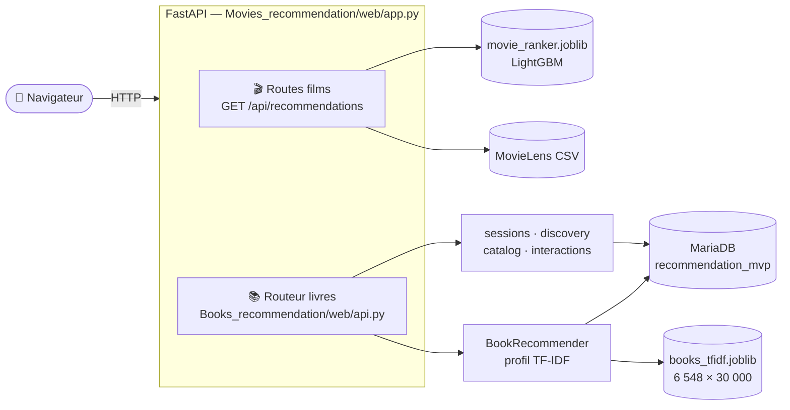
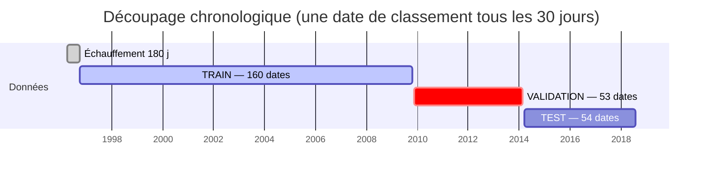
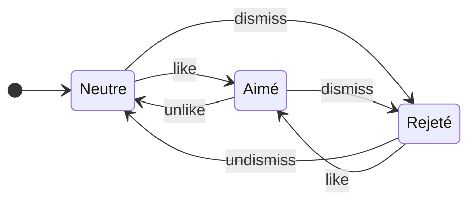
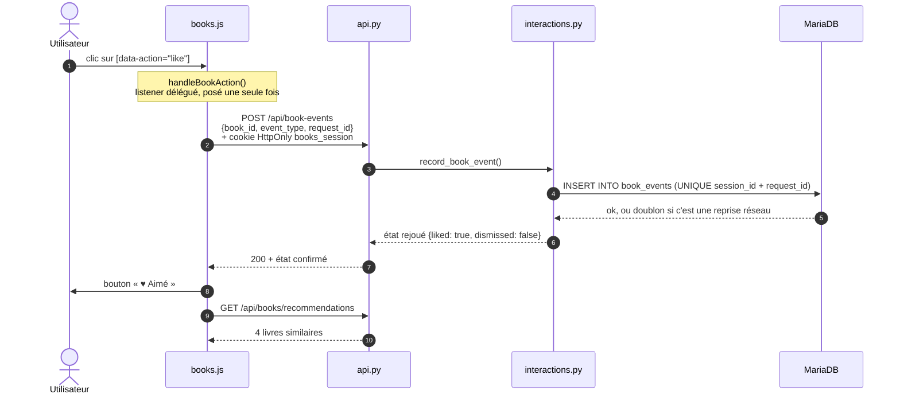
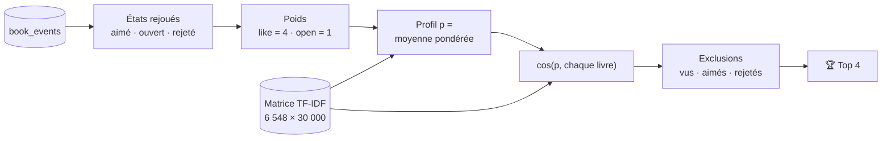
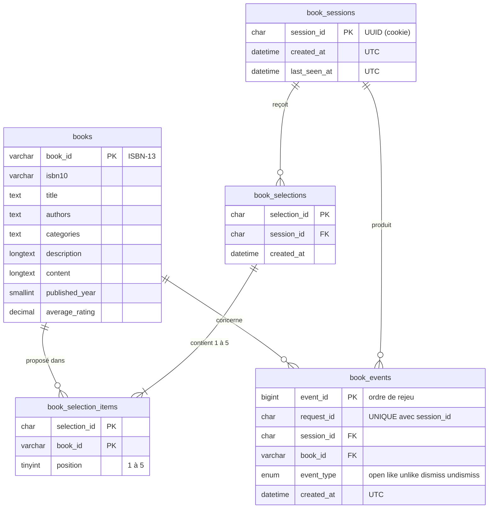
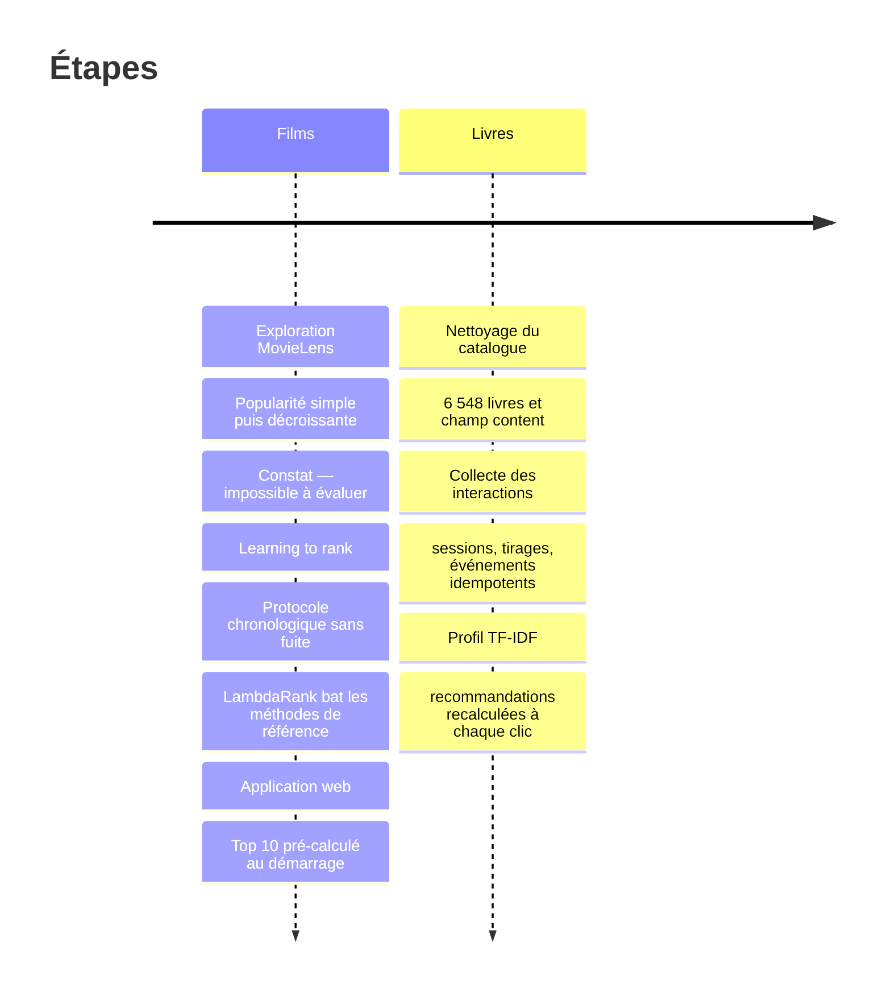
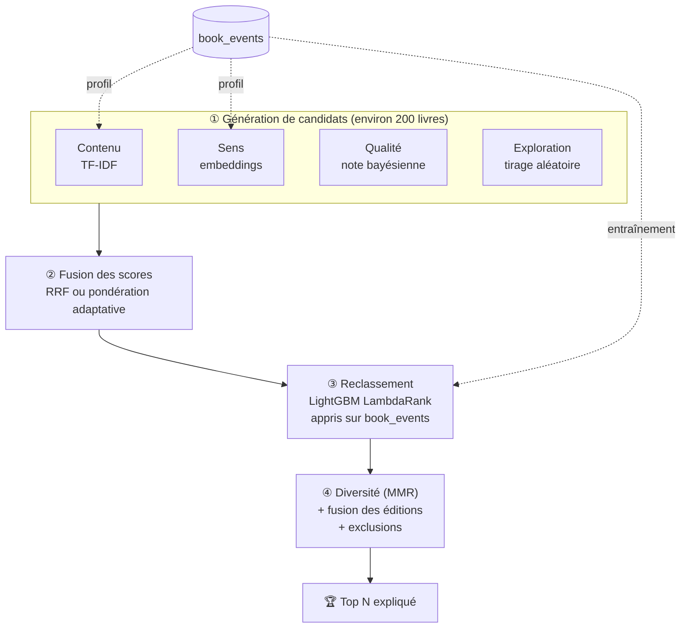

<div align="center">

# 🎬📚 Système de recommandation — Films & Livres

**Deux approches de la recommandation dans une même application web :
un classement appris par machine learning pour les films, et une recommandation
personnalisée par le contenu, nourrie par les interactions, pour les livres.**


[Vue d'ensemble](#-vue-densemble) ·
[Films](#-module-films--apprendre-à-classer) ·
[Livres](#-module-livres--de-linteraction-à-la-recommandation) ·
[Démarrage](#-installation-et-lancement-windows) ·
[Journal](#-comment-sest-déroulé-le-projet) ·
[Perspectives](#-perspectives--vers-un-moteur-hybride-et-sémantique)

</div>

---

## 🧭 Vue d'ensemble

Ce projet pédagogique explore **deux familles de recommandation** et les met en
production dans une seule application FastAPI :

| | 🎬 **Films** | 📚 **Livres** |
|---|---|---|
| **Question posée** | *Quels films vont plaire au plus grand nombre dans les 30 prochains jours ?* | *Quels livres ressemblent à ce que **cet** utilisateur aime ?* |
| **Famille** | Learning to rank (classement global) | Filtrage par le contenu (personnalisé) |
| **Signal** | Historique des notes MovieLens | Clics réels : ouvrir, aimer, écarter |
| **Modèle** | LightGBM LambdaRank, 11 variables temporelles | Profil TF-IDF pondéré + similarité cosinus |
| **Données** | 100 836 notes, 9 742 films (1996 → 2018) | 6 548 livres, 30 000 termes |
| **Page** | `/` | `/books` |



Une seule application, un seul port. La page films ne dépend **pas** de MySQL :
elle fonctionne même si XAMPP est arrêté.

---

## 🎬 Module films : apprendre à classer

### L'idée

Le premier réflexe est de classer les films par **popularité** (nombre de notes),
puis par **popularité récente** (chaque note perd la moitié de son poids tous les
30 jours). Ces classements sont faciles à calculer, mais on ne peut pas les
**évaluer** : rien ne dit s'ils prédisent bien ce qui plaira ensuite.

Le projet reformule donc le problème en apprentissage supervisé : **à une date
donnée, ordonner les films selon le nombre d'utilisateurs qui les noteront
positivement (≥ 4/5) dans les 30 jours suivants**. Ce problème se mesure, et donc
se compare.

### Le protocole : aucune fuite du futur



- À chaque **date de référence** *t*, les variables sont calculées **uniquement
  avec les notes antérieures à t**.
- La cible regarde la fenêtre **[t, t + 30 j[** : le nombre d'utilisateurs
  positifs futurs, converti en 5 niveaux de pertinence
  (0 · 1–2 · 3–6 · 7–14 · 15+) avec des gains `[0, 1, 3, 7, 15]`.
- Le découpage est **chronologique** : on entraîne sur le passé, on arrête
  l'entraînement (early stopping) sur la validation, et on mesure sur un test
  jamais vu.
- Seuls les films ayant au moins 5 évaluateurs passés sont candidats.

### Les 11 variables

| Famille | Variables |
|---|---|
| Volume historique | `past_users`, `past_positive_users` |
| Qualité | `past_mean_rating`, `mean_rating_30d` |
| Dynamique récente | `users_7d`, `users_30d`, `users_90d`, `positive_users_30d` |
| Tendance | `trend_30d` (30 derniers jours moins les 30 précédents) |
| Mémoire décroissante | `decayed_popularity` (demi-vie 30 j), `days_since_last_rating` |

### Le modèle et ses résultats

`LGBMRanker(objective="lambdarank")` : 15 feuilles, profondeur 5,
taux d'apprentissage 0,03, arrêt à la **131ᵉ itération** (NDCG@10 de validation : 0,385).

| Méthode (jeu de test, 54 dates) | NDCG@10 | Capture des positifs @10 |
|---|:---:|:---:|
| 🥇 **LambdaRank (ce projet)** | **0,460** | **5,45 %** |
| Popularité cumulée | 0,432 | 5,16 % |
| Popularité décroissante (demi-vie 30 j) | 0,410 | 4,83 % |
| Popularité récente (30 j) | 0,299 | 3,51 % |

> Le modèle bat les trois méthodes de référence, mais l'écart avec la popularité
> cumulée reste modeste et la variance est forte (σ ≈ 0,25). Sur un petit jeu comme
> MovieLens *small* (610 utilisateurs), la popularité reste difficile à battre.
> Le score affiché sur la page est **relatif** : ce n'est ni une note ni une probabilité.

La page web affiche le Top 10 à la date « dernière note + 1 seconde »
(24 septembre 2018). Il est calculé une seule fois au démarrage du serveur.

---

## 📚 Module livres : de l'interaction à la recommandation

### Les données

Le catalogue vient de *7k Books with metadata* : 6 810 livres avec titre,
sous-titre, auteurs, catégories, description et note moyenne. Le nettoyage
([data_book_analysis.py](Books_recommendation/data_book_analysis.py)) :

1. normalise les espaces et transforme les textes vides en valeurs manquantes ;
2. vérifie que les ISBN-13 sont uniques, puis s'en sert comme identifiant stable `book_id` ;
3. écarte les livres sans titre ni description : **il en reste 6 548** ;
4. construit un champ commun `content` = titre + sous-titre + catégories + description,
   qui servira aussi bien à TF-IDF qu'à de futurs embeddings.

### Étape 1 — collecter des faits, pas des opinions

La page `/books` sert **5 livres tirés au hasard**. Le hasard est volontaire : il
évite de n'apprendre que sur les livres déjà populaires. Chaque action de
l'utilisateur devient une ligne **brute et horodatée** dans MySQL.

| Événement | Déclencheur | Effet sur l'état |
|---|---|---|
| `open` | la fiche du livre s'est chargée | compteur d'ouvertures + 1 |
| `like` / `unlike` | bouton « J'aime » | aimé ↔ neutre ; un like annule un rejet |
| `dismiss` / `undismiss` | bouton « Pas intéressé » | rejeté ↔ neutre ; un rejet annule un like |

L'état d'un livre n'est jamais stocké : il est **reconstruit** en rejouant les
événements dans l'ordre `event_id`. La base garde donc tout l'historique, et
changer les règles plus tard ne demande aucune migration.



#### Le trajet d'un clic « J'aime »



Garanties de cette collecte :

- **Session côté serveur** : un UUID est placé dans un cookie `HttpOnly` et
  `SameSite=Lax` (plus `Secure` en HTTPS). Un `session_id` envoyé par le client est refusé.
- **Idempotence** : chaque action porte un `request_id`, réutilisé lors des
  reprises réseau. La contrainte UNIQUE empêche les doublons, même quand deux
  envois arrivent à la même milliseconde.
- **Confirmation avant affichage** : le bouton ne change qu'après la réponse du
  serveur. En cas d'échec, un lien « Réessayer » réutilise le même `request_id`.
- **Sélections persistées** : actualiser la page ne relance pas le tirage. Le
  tirage suivant privilégie les livres jamais proposés et exclut toujours les livres rejetés.

### Étape 2 — le profil TF-IDF

Chaque livre devient un vecteur TF-IDF de 30 000 dimensions (unigrammes et
bigrammes, `sublinear_tf`, normalisation L2). Le profil de l'utilisateur est la
**moyenne pondérée** des vecteurs des livres avec lesquels il a interagi
([Book_recommender.py](Books_recommendation/Book_recommender.py)) :

$$
\vec{p} \;=\; \frac{\sum_{i} w_i \,\vec{x}_i}{\sum_i w_i}
\qquad
w_i = 4\cdot\mathbb{1}[\text{aimé}_i] + 1\cdot\mathbb{1}[\text{ouvert}_i]
\qquad
\text{score}(j) = \cos(\vec{p}, \vec{x}_j)
$$

- Un like pèse **4 fois** plus qu'une ouverture. Ouvrir dix fois un livre compte comme une seule ouverture.
- Les livres rejetés sont exclus du profil **et** des résultats.
- Les livres déjà aimés ou ouverts ne sont plus recommandés.
- Sans interaction, le système répond `cold_start` et la page invite à aimer un premier livre.



**Exemple réel** : après trois likes sur des livres *Harry Potter*, le système propose

| Rang | Livre | Similarité |
|:-:|---|:-:|
| 1 | The Harry Potter Collection | 0,60 |
| 2 | Harry Potter and the Chamber of Secrets (Book 2) | 0,37 |
| 3 | Harry Potter and the Goblet of Fire | 0,32 |
| 4 | Harry Potter and the Prisoner of Azkaban | 0,28 |

La section « Recommandés pour vous » se recalcule après **chaque** interaction confirmée.
L'exemple montre aussi les limites de TF-IDF : le système recommande une autre
édition d'un livre déjà aimé, et ne comprend que les mots exacts. C'est le point
de départ des [perspectives](#-perspectives--vers-un-moteur-hybride-et-sémantique).

### Le schéma de la base



---

## 🚀 Installation et lancement (Windows)

**Prérequis** : Python 3.14, [uv](https://docs.astral.sh/uv/), XAMPP (MySQL/MariaDB).

```powershell
# 1. Dépendances
uv sync
#    ou : .venv\Scripts\python.exe -m pip install -r requirement.txt

# 2. Configuration (puis adapter le mot de passe MySQL si besoin)
Copy-Item .env.example .env

# 3. Démarrer MySQL dans XAMPP, puis créer les tables si elles n'existent pas
#    (le script est non destructif : CREATE TABLE IF NOT EXISTS)
cmd /c "C:\xampp\mysql\bin\mysql.exe -u root < Books_recommendation\sql\schema.sql"

# 4. Importer le catalogue (relançable : met à jour, ne crée jamais de doublon)
.venv\Scripts\python.exe -m Books_recommendation.import_books

# 5. Lancer l'application
.venv\Scripts\python.exe -m uvicorn Movies_recommendation.web.app:app --port 8000 --reload
```

| Page | Adresse |
|---|---|
| 🎬 Films | <http://127.0.0.1:8000/> |
| 📚 Livres | <http://127.0.0.1:8000/books> |
| 📖 Documentation interactive de l'API | <http://127.0.0.1:8000/docs> |

<details>
<summary><b>Données à placer</b> (non versionnées)</summary>

| Fichier | Source | Utilisé par |
|---|---|---|
| `movies_Data/movies.csv`, `ratings.csv` | [MovieLens latest-small](https://grouplens.org/datasets/movielens/latest/) | module films |
| `Books_data/data.csv` | [7k Books with metadata (Kaggle)](https://www.kaggle.com/datasets/dylanjcastillo/7k-books-with-metadata) | nettoyage et TF-IDF |

`Books_recommendation/data/books_clean.csv` et les deux artefacts `.joblib` sont versionnés.
</details>

<details>
<summary><b>Régénérer les modèles</b></summary>

```powershell
# Films : exécuter le notebook Movies_recommendation/Data_analysis.ipynb
#         -> Movies_recommendation/artifacts/movie_ranker.joblib

# Livres : nettoyage + matrice TF-IDF
.venv\Scripts\python.exe -m Books_recommendation.data_book_analysis
#         -> Books_recommendation/artifacts/books_tfidf.joblib

# Livres : recommandations d'une session, sans serveur web
.venv\Scripts\python.exe -m Books_recommendation.Book_recommender --session-id <uuid> --top-k 5
```

Après avoir régénéré la matrice TF-IDF, relancer l'import pour que la base et
l'artefact contiennent les mêmes `book_id`.
</details>

<details>
<summary><b>Explorer la base</b></summary>

```sql
-- interactions avec le titre du livre
SELECT e.event_id, e.event_type, b.title, e.created_at
FROM book_events e JOIN books b ON b.book_id = e.book_id
ORDER BY e.event_id DESC;

-- livres servis à chaque tirage
SELECT s.created_at, i.position, b.title
FROM book_selections s
JOIN book_selection_items i ON i.selection_id = s.selection_id
JOIN books b ON b.book_id = i.book_id
ORDER BY s.created_at DESC, i.position;
```
</details>

### API

| Méthode | Route | Rôle |
|---|---|---|
| `GET` | `/api/recommendations` | Top 10 global des films |
| `GET` | `/api/books/discovery` | sélection courante (tirage seulement s'il n'en existe aucune) |
| `POST` | `/api/books/discovery/refresh` | nouveau tirage « Découvrir d'autres livres » |
| `GET` | `/api/books/recommendations?top_k=4` | recommandations TF-IDF de la session |
| `GET` | `/api/books?query=…&page=1&page_size=20` | recherche par titre, paginée |
| `GET` | `/api/books/{book_id}` | fiche complète + état pour la session |
| `POST` | `/api/book-events` | enregistre une interaction |

Les routes fixes sont déclarées **avant** `/api/books/{book_id}`. Sinon
« discovery » ou « recommendations » seraient pris pour un identifiant de livre.

---

## 🗂️ Structure du dépôt

```
.
├── Movies_recommendation/
│   ├── Data_analysis.ipynb        exploration, protocole et entraînement LambdaRank
│   ├── artifacts/movie_ranker.joblib
│   ├── model_generalise.py        build_features() + recommend_movies()
│   ├── test.py                    chargement des données + démo console
│   └── web/
│       ├── app.py                 ⭐ application FastAPI (point d'entrée unique)
│       └── static/                page films (HTML/CSS/JS) + styles partagés
├── Books_recommendation/
│   ├── data_book_analysis.py      nettoyage + matrice TF-IDF -> artifacts/
│   ├── test_similarity.py         livres proches d'un livre + export books_clean.csv
│   ├── Book_recommender.py        ⭐ profil pondéré + similarité cosinus
│   ├── import_books.py            CSV -> MySQL (upsert relançable)
│   ├── db.py                      configuration .env + moteur SQLAlchemy
│   ├── sessions.py                cookie de session HttpOnly
│   ├── discovery.py               tirage aléatoire des 5 livres
│   ├── catalog.py                 fiche + recherche
│   ├── interactions.py            ⭐ écriture et rejeu des événements
│   ├── sql/schema.sql             schéma des 5 tables
│   └── web/
│       ├── api.py                 routes du module (APIRouter)
│       └── static/                books.html · books.js · books.css
├── .env.example                   modèle de configuration (copier en .env)
├── pyproject.toml · uv.lock · requirement.txt
└── README.md
```

---

## 📓 Comment s'est déroulé le projet



**Ce que les difficultés ont appris** :

| Problème rencontré | Cause | Leçon retenue |
|---|---|---|
| `FileNotFoundError` sur les CSV et le modèle | chemins relatifs au dossier de lancement | toujours partir de `Path(__file__)` |
| `KeyError: 'datetime'` | colonne créée dans le notebook mais pas dans le script | une seule fonction `load_data()` partagée |
| ISBN tronqués | `0002005883` lu comme un nombre | lire les identifiants comme du **texte** |
| `/api/books/recommendations` → 404 | capturé par `/api/books/{book_id}` | déclarer les routes fixes avant les routes génériques |
| « J'aime ne change rien » | ancien `books.js` gardé en cache par le navigateur | en-tête `Cache-Control: no-cache` |
| 503 lors d'envois simultanés | en REPEATABLE READ, la relecture voyait une photo périmée de la base | lecture verrouillante `LOCK IN SHARE MODE` |
| Détection de doublon faussée | SQLAlchemy active `FOUND_ROWS` : `rowcount` vaut 1 même sans écriture | ne pas se fier à `rowcount` après `ON DUPLICATE KEY` |
| Variables `DB_*` ≠ `BOOKS_DB_*` | deux modules écrits séparément | une seule convention de configuration |

---

## 🔭 Perspectives : vers un moteur hybride et sémantique

### 1. Des embeddings à la place de TF-IDF

TF-IDF compare des **mots**, les embeddings comparent du **sens** :

| | TF-IDF (actuel) | Embeddings de phrases |
|---|---|---|
| « wizard school » vs « magic academy » | ❌ aucun mot commun → similarité 0 | ✅ sens proche |
| Requêtes en français sur un catalogue anglais | ❌ | ✅ avec un modèle multilingue |
| Vecteur | creux, 30 000 dimensions | dense, 384 à 768 dimensions |
| Coût | instantané, sans GPU | encodage unique du catalogue (quelques minutes sur CPU) |

Le champ `content` a été préparé pour ce changement. Avec un modèle comme
`paraphrase-multilingual-MiniLM-L12-v2` ou `multilingual-e5-small`
(sentence-transformers), on encode les 6 548 livres une fois et on sauvegarde la
matrice dans `artifacts/books_embeddings.npy`. `Book_recommender` reste
identique : seule la matrice change, et le profil pondéré fonctionne de la même façon.

**Recherche sémantique** : la barre de recherche, aujourd'hui par titre, pourrait
accepter une description libre (« un polar nordique avec une enquêtrice »). La
requête est encodée avec le même modèle et comparée à tout le catalogue. Avec
6 548 livres, un simple produit matriciel NumPy suffit. Un index FAISS ou
`pgvector` ne deviendra utile qu'au-delà de centaines de milliers de livres.

### 2. Un seul algorithme qui combine toutes les stratégies

L'idée est de ne plus choisir **une** méthode, mais de les faire travailler
ensemble en trois temps : **générer** des candidats, les **classer**, puis
**diversifier** la liste.



**① Profil enrichi (Rocchio)** : utiliser aussi les rejets, qui sont aujourd'hui seulement exclus,
et donner moins de poids aux interactions anciennes :

$$
\vec{p} = \alpha\,\overline{\vec{x}}_{\text{aimés}} + \beta\,\overline{\vec{x}}_{\text{ouverts}} - \gamma\,\overline{\vec{x}}_{\text{rejetés}}
\qquad w_i \leftarrow w_i \cdot 2^{-\Delta t_i / \tau}
$$

**② Fusion adaptative au démarrage à froid** : la part de personnalisation augmente
avec le nombre *n* d'interactions de la session :

$$
\text{score}(j) = \lambda_n \big[\,a\cdot\cos_{\text{emb}}(j) + (1-a)\cdot\cos_{\text{tfidf}}(j)\,\big] + (1-\lambda_n)\cdot\text{qualité}(j),
\qquad \lambda_n = \frac{n}{n + k}
$$

La qualité est une **moyenne bayésienne**, pour qu'un 5/5 obtenu avec 3 notes ne
batte pas un 4,3/5 obtenu avec 50 000 notes :

$$
\text{qualité}(j) = \frac{v_j\,R_j + m\,C}{v_j + m}
$$

($v_j$ : nombre de notes du livre, $R_j$ : sa moyenne, $C$ : moyenne du catalogue, $m$ : seuil de confiance.)
Une alternative sans réglage de poids est la *Reciprocal Rank Fusion* :
$\sum_s 1/(60 + \text{rang}_s(j))$.

**③ Reclassement appris** : on réutilise le savoir-faire du module films. Chaque
tirage stocké dans `book_selections` et ses suites dans `book_events` forment un
jeu de données de classement. Like = 2, ouverture = 1, servi sans clic = 0,
rejet = négatif. Un `LGBMRanker` apprendrait la meilleure combinaison des scores
TF-IDF, embedding, qualité, popularité et récence, à la place de poids fixés à la main.

**④ Diversité (MMR)** : chaque livre ajouté à la liste pénalise ceux qui lui
ressemblent trop. Cela évite quatre éditions de la même saga :

$$
\text{MMR}(j) = \mu\cdot\text{score}(j) - (1-\mu)\cdot\max_{s \in \text{liste}} \cos(\vec{x}_j, \vec{x}_s)
$$

On ajoute à cela le regroupement des éditions d'une même œuvre (titre normalisé + auteur).

### 3. Mesurer avant d'améliorer

| Niveau | Mesure |
|---|---|
| Hors ligne | on cache le dernier like de chaque session et on vérifie s'il revient (*leave-one-out*) : HitRate@K, NDCG@K |
| En ligne | taux de like par livre **servi**, rendu possible par `book_selections` ; taux de rejet |
| Comparaison | A/B test TF-IDF vs embeddings vs hybride, la stratégie étant tirée par session |
| Qualité de liste | diversité moyenne et couverture du catalogue (évite que tout le monde reçoive les mêmes livres) |

### 4. Autres pistes

- **Comptes utilisateurs** : rattacher plusieurs sessions anonymes à une même personne.
- **Filtrage collaboratif** : quand le nombre de sessions sera suffisant, ajouter une
  factorisation de matrice (ALS) comme générateur de candidats supplémentaire.
- **Personnaliser les films** avec le même mécanisme d'interactions, en reprenant le
  classement LambdaRank comme score de qualité.
- **Explications** : afficher pour chaque livre recommandé *« parce que vous avez aimé X »*,
  en montrant les livres du profil qui y contribuent le plus.

---

## ⚠️ Limites connues

- Le classement des films est **global** : il ne dépend pas de l'utilisateur.
- TF-IDF ne retire pas les mots vides anglais (`stop_words=None`) ; la
  pondération IDF les atténue sans les supprimer.
- Les éditions multiples d'un même livre ne sont pas regroupées.
- `Book_recommender` ouvre sa propre connexion PyMySQL au lieu de réutiliser
  le moteur SQLAlchemy de `db.py`.
- Le projet n'a pas encore de suite de tests automatisés dans le dépôt : les
  vérifications de bout en bout (sessions, idempotence, concurrence,
  recommandations) ont été lancées à la main.
- La dépendance `display` de `pyproject.toml` n'est utilisée nulle part : `IPython.display` vient d'`ipykernel`.

<div align="center">

---

*Projet pédagogique : données MovieLens (GroupLens) et 7k Books with metadata (Kaggle).*

</div>
